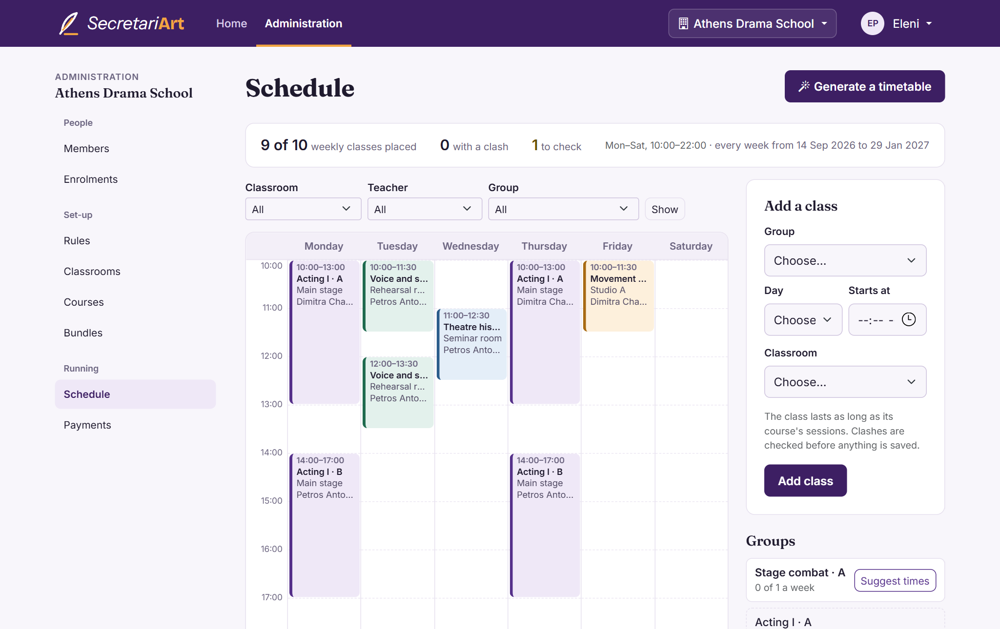
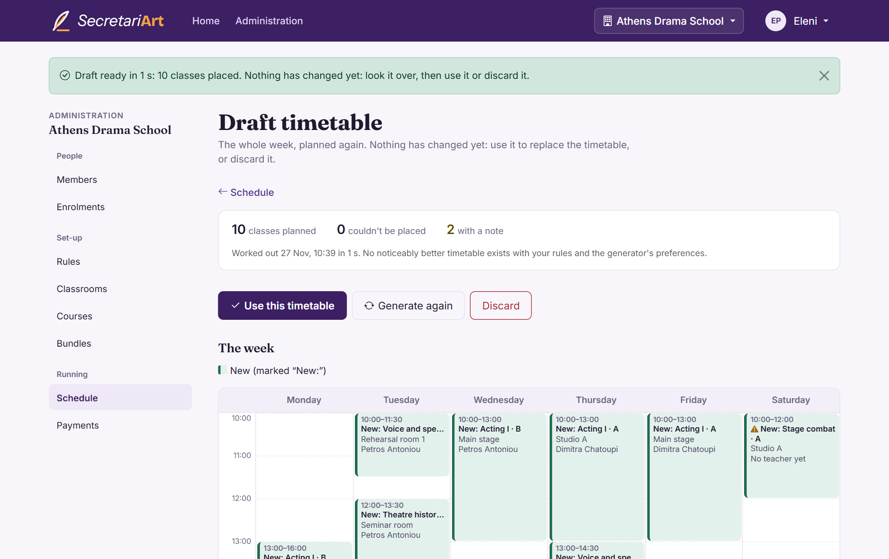
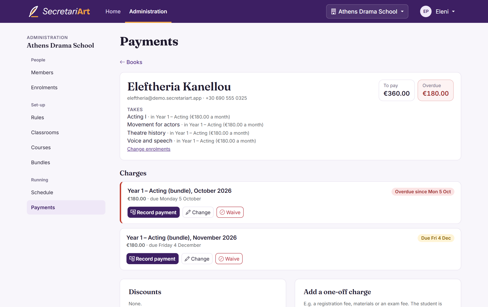
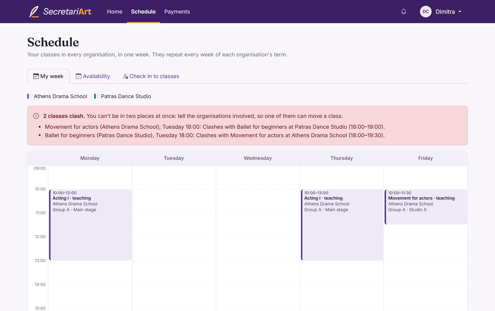
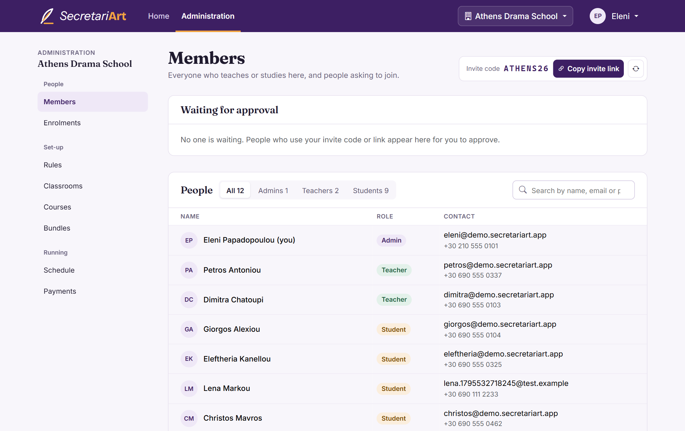
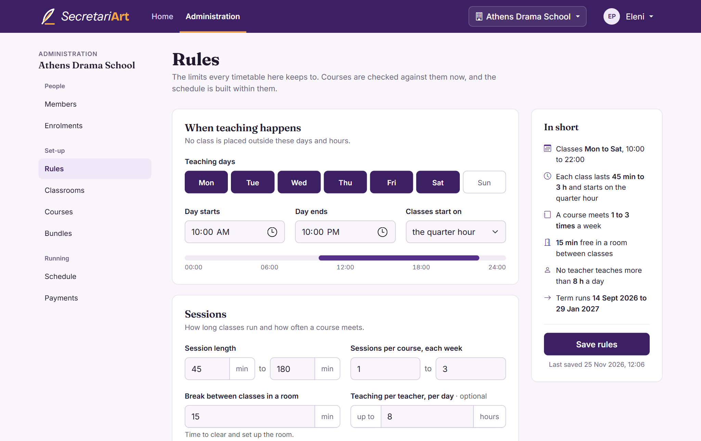
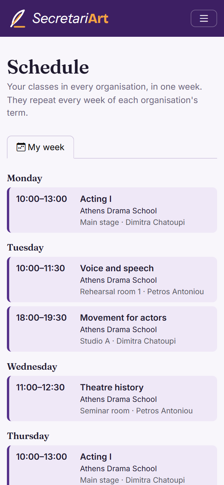

# SecretariArt

[](https://github.com/parisoiko/SecretariArt/actions/workflows/ci.yml)


**The front office for schools of the arts.** SecretariArt helps drama schools, conservatoires, dance studios, ateliers
and rehearsal spaces with the hardest part of running them: fitting students, courses, teachers and classrooms into a
weekly timetable, and keeping track of who owes what.

I worked at a drama school's front office, where all of this was done by hand. The same teacher taught at a dance studio
across town, students took classes at both, and each school planned its week alone. SecretariArt is the tool I wished
we'd had: one account per person across every school they belong to, a timetable editor that knows about everyone's
other commitments, a solver that drafts the whole week, and payment books that keep themselves up to date.



## What it does

| Who | What they can do |
|---|---|
| **Admin** | sets the school's rules (days, hours, changeover time, teaching limits); manages classrooms with their features, courses with groups and bundles, and enrolments; builds the timetable by hand or has it **generated**; sets prices and discounts; records payments and chases overdue ones; approves who joins |
| **Teacher** | posts their weekly availability; sees what they teach, where and when, across every school; marks no-shows on check-in lists |
| **Student** | sees their week across every school they attend, with clashes flagged; checks in to pay-per-class sessions; sees what they owe and when it's due |
| **Platform admin** | approves new organisations |

- **One account everywhere:** the same person can teach at one school and study at another. Roles come from memberships, not from separate logins.
- **Conflict checks while you edit:** room double-bookings, teachers or students in two places (even at another school), rooms without a piano or mirrors when the course needs one. Real conflicts are refused; softer ones (outside a teacher's availability, a small room) are saved with a warning.
- **Automatic timetables:** Google OR-Tools' CP-SAT solver fills the gaps or plans the week from scratch, and respects the school's own order of priorities. The result is a draft to review, never a surprise.
- **Payments:** monthly fees billed automatically, or per class attended with check-ins and places per class. Bundles, stacked discounts, due days, reminders and an overdue list. Billing is idempotent, so it runs whenever a page opens and hourly in the background.
- **Notifications** when a class moves, a request is decided or a fee is due.
- **Self-service accounts:** edit your details, change your password, reset a forgotten one by email.

| Generated draft | A student's statement |
|---|---|
|  |  |

| My schedule, across two schools | Members and join requests |
|---|---|
|  |  |

| School rules | On a phone |
|---|---|
|  |  |

## How it's built

| Concern | How | Where |
|---|---|---|
| Multi-tenancy | every organisation-owned row has `OrganizationId`; services take it on every lookup | `Services/`, `Data/SecretariArtDbContext.cs` |
| Authorization | a fallback "signed in" policy; an `OrganizationAdmin` policy that reads the organisation from the route (and refuses a form that names another) | `Authorization/`, `Controllers/OrganizationAdminController.cs` |
| Clash rules | one pure checker (problems refuse, warnings note), shared by the editor, enrolments, the generator and drafts | `Services/ScheduleChecker.cs` |
| Timetable generation | CP-SAT over one week axis in minutes: optional intervals, no-overlap per room/teacher/group/student, ordered soft costs | `Services/TimetableGenerator.cs` |
| Billing | idempotent charges keyed per course, student and month, made on page load and by a hosted service | `Services/BillingService.cs`, `Services/BillingWorker.cs` |
| Time | the school's time zone (Europe/Athens) and an injected `TimeProvider`, so tests can move the clock | `Services/SchoolTime.cs` |
| Security | Identity with lockout, password reset, rate limits, CSP with per-request nonces, anti-forgery on every POST | `Extensions/RateLimiting.cs`, `Extensions/SecurityHeaders.cs` |
| Hosting | health check, forwarded headers behind a proxy, persisted data-protection keys, Dockerfile | `Extensions/HostingExtensions.cs`, `Dockerfile` |

The reasoning behind these, and the alternatives I turned down, is in [docs/NOTES.md](docs/NOTES.md).

### Tech stack

| Area | Technology |
|---|---|
| Web | ASP.NET Core 10 MVC, Razor views, Bootstrap 5 |
| Data | EF Core 10, SQL Server (LocalDB in development), migrations applied at start-up |
| Accounts | ASP.NET Core Identity |
| Solver | Google OR-Tools CP-SAT |
| Tests | xUnit: service tests on in-memory SQLite, `WebApplicationFactory` integration tests through the real forms |
| QA | a separate Claude agent driving the app with Playwright from a written test plan ([qa/](qa/README.md)) |
| CI | GitHub Actions: build, test and build the Docker image on every push |

### Project structure

```
src/SecretariArt/
├── Authorization/    the OrganizationAdmin policy
├── Controllers/      thin: admin tabs derive from OrganizationAdminController
├── Data/             DbContext, migrations, start-up seeding (demo data in Development)
├── Extensions/       service registration, rate limits, security headers, hosting
├── Models/           entities: organisations, memberships, courses, sessions, charges…
├── Services/         business rules, each returning a ServiceResult; the checker and the generator
├── ViewComponents/   admin sidebar, main navigation
├── ViewModels/       one per form, [Required] always explicit
└── Views/            Razor views
tests/SecretariArt.Tests/   Services/ (unit) and Integration/ (whole app in memory)
qa/                         the QA agent's test plan and launcher
docs/                       design notes and screenshots
```

## Getting started

**Requirements:** the [.NET 10 SDK](https://dotnet.microsoft.com/download) and SQL Server LocalDB (part of Visual Studio,
or the free SQL Server Express installer) on Windows. Elsewhere, use Docker (below).

```bash
git clone https://github.com/parisoiko/SecretariArt.git
cd SecretariArt
dotnet run --project src/SecretariArt
```

Open http://localhost:5100. On first start the database is created and, in Development, filled with two schools,
their courses, a timetable, enrolments and last month's fees. Every demo account's password is `Demo!2026`:

| Email | Who |
|---|---|
| `eleni@demo.secretariart.app` | admin of Athens Drama School (invite code `ATHENS26`) |
| `nikos@demo.secretariart.app` | admin of Patras Dance Studio (invite code `PATRAS26`) |
| `dimitra@demo.secretariart.app` | teaches at Athens, studies ballet at Patras (her Tuesday 18:00 clashes on purpose) |
| `giorgos@demo.secretariart.app` | student at Athens |
| `platform@demo.secretariart.app` | platform admin: approves new organisations |

Things to try:
- As Eleni, open **Schedule** and add a class: pick a group, a room and a time, and watch the checks.
  Then **Generate** → *Start over* for a whole new week, compare, and discard or use it.
- As Dimitra, open **My schedule**: Athens teaching and Patras ballet in one week, with the clash flagged.
- **Forgot your password?** on the sign-in page: in Development the email is saved as an `.eml` file under
  `src/SecretariArt/App_Data/mail` instead of being sent.

## Tests

```bash
dotnet test
```

**Service tests** cover each service against SQLite in memory with a movable clock: the clash rules, the generator's
priorities, billing across month ends and price changes, check-ins and cancellations. **Integration tests** start the
whole app in memory and go through the real forms with anti-forgery tokens. They cover sign-in, registration and
password reset, organisation requests, invite codes and approvals, authorization between organisations (including a
form that names a different school), every admin tab, rate limits and the security headers.

On top of that, each milestone was tested by a QA agent: a separate Claude session that drives a copy of the app in a
browser, following [qa/TESTER.md](qa/TESTER.md). Its findings were fixed and retested before each milestone was closed.

## Deploying

The app is a standard ASP.NET Core app with SQL Server. A container image builds from the `Dockerfile`, and
`docker-compose.yml` runs it with a SQL Server next to it:

```bash
SA_PASSWORD='Choose-a-strong-one1' ADMIN_PASSWORD='Another-strong-one1' docker compose up --build
```

Settings (environment variables use `__` for nesting, e.g. `Email__PublicUrl`):

| Setting | What it's for |
|---|---|
| `ConnectionStrings:SecretariArt` | the SQL Server database; migrations are applied at start-up |
| `PlatformAdmin:Email`, `:Password`, `:FirstName`, `:LastName` | the first platform admin, created at start-up if missing |
| `Email:PublicUrl` | the site's public address, for links in emails (password reset) |
| `DataProtection:KeysDirectory` | where sign-in keys are kept, so a restart doesn't sign everyone out (set in the image to `/data/keys`; mount a volume) |
| `ForwardedHeaders:Enabled`, `:KnownProxies`, `:KnownNetworks` | behind a reverse proxy: trust its `X-Forwarded-For`/`-Proto`, so rate limits see real visitors and HTTPS is detected |
| `RateLimits:*` | per-action limits (see `Extensions/RateLimiting.cs`) |
| `Generation:TimeLimitSeconds`, `:MaxConcurrent` | how long one timetable generation may take, and how many may run at once |

`GET /health` answers 200 when the database is reachable, for a load balancer to probe. Emails are written to a folder
in this version; sending real ones is a matter of implementing `IEmailSender` (`Services/EmailSender.cs`) for an SMTP
server or an email service.

## Status

Built in six milestones: accounts and organisations · administration · schedules by hand · payments · automatic timetable
generation · polish (account self-service, a security review, accessibility, deployment, documentation). Ideas for later:
online payments, real email delivery, calendar export (iCal), and Greek alongside English.

## License

[MIT](LICENSE)
